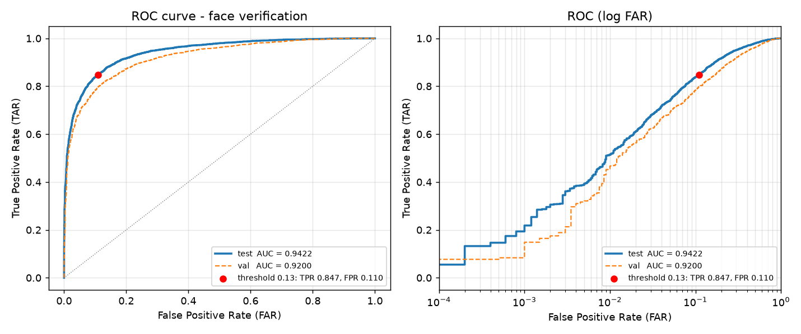
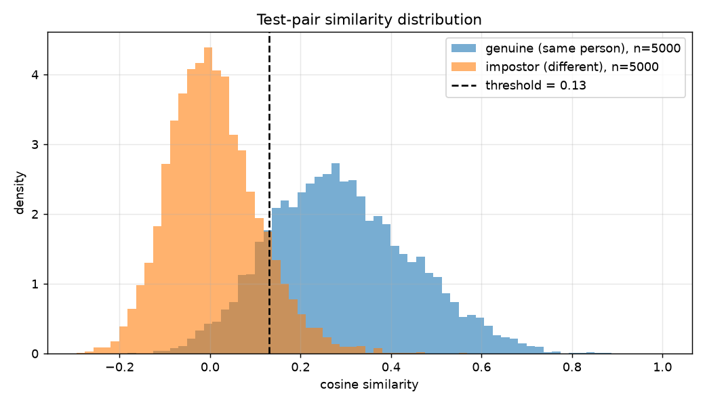
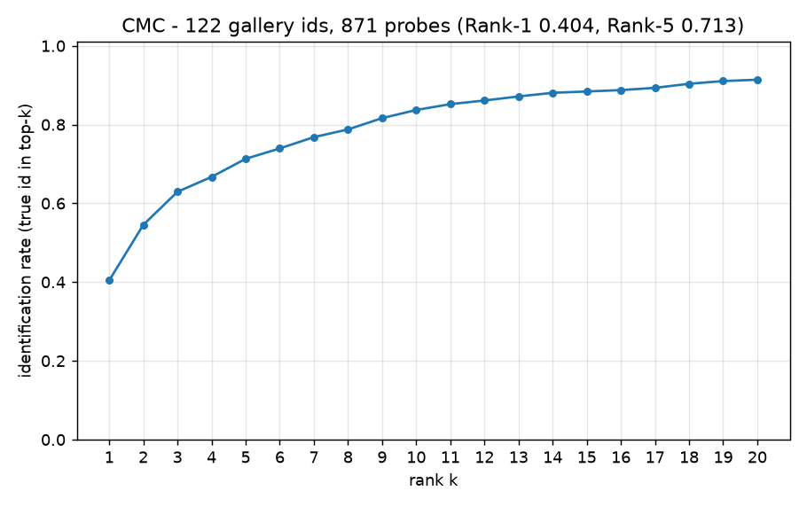
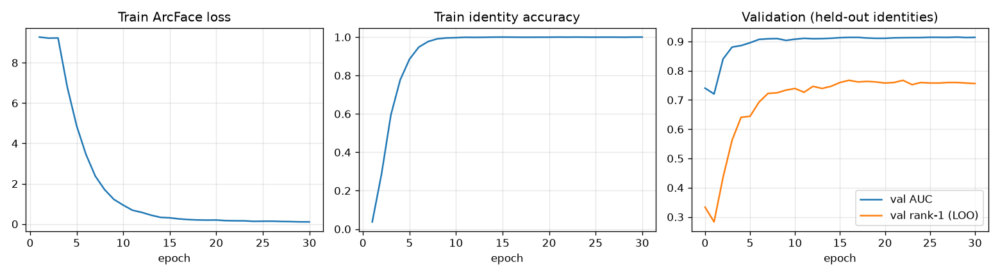

# Face Verification & Re-Identification with ResNet50 + ArcFace

  

An end-to-end face recognition pipeline in PyTorch: dataset preparation, metric-learning training, pair-based verification, gallery/probe identification and threshold analysis, all evaluated on people the model never saw in training.


A ResNet50 (ImageNet-pretrained) is fine-tuned with an **ArcFace** loss to output **512-D L2-normalised face
embeddings**. Two faces are compared by **cosine similarity** (verification), and probe faces are matched
against an enrolled **gallery** (identification). All evaluation uses identities that are **not** in training.

| Result (held-out test identities) | Value |
|---|---|
| Test pairs | 5,000 genuine + 5,000 impostor |
| **ROC-AUC** | **0.9422** |
| EER | 0.1307 |
| TAR @ FAR = 1% / 0.1% | 0.5142 / 0.2184 |
| **Cosine threshold** (chosen on validation) | **0.13** |
| Accuracy / Precision / Recall / F1 @ 0.13 | 0.8688 / 0.8853 / 0.8474 / 0.8659 |
| FAR / FRR @ 0.13 | 0.1098 / 0.1526 |
| **Rank-1** (122-id gallery, 1 img/id, 871 probes) | **0.4041** (chance 0.0082) |
| Rank-5 / Rank-10 | 0.7130 / 0.8370 |

Full numbers: `results/evaluation_results.json`. Full write-up: [`report.pdf`](report.pdf).

<p align="center"> </p>
<p align="center"> </p>

---

## 1. Dataset

### 1.1 Description

**Labeled Faces in the Wild (LFW)** is a public benchmark for unconstrained face verification. It contains
13,233 face photographs of 5,749 people collected from news articles on the web, and 1,680 of those people
have two or more images. Every image is 250×250 pixels and centred on one face that was detected with the
Viola-Jones detector, and each image is labelled with the person's name. The subjects are public figures
(politicians, athletes, entertainers) photographed in everyday news settings, so pose, lighting, expression,
age and image quality vary naturally.

This project uses the **deep-funneled** version, in which every image has been aligned by unsupervised joint
alignment (Huang et al., NIPS 2012). That alignment is why no additional landmark alignment step is needed here.

### 1.2 Source

| | |
|---|---|
| Dataset owner | Computer Vision Laboratory, University of Massachusetts Amherst |
| Official page | <http://vis-www.cs.umass.edu/lfw/> |
| Copy used here | Kaggle mirror [`jessicali9530/lfw-dataset`](https://www.kaggle.com/datasets/jessicali9530/lfw-dataset) (the `lfw-deepfunneled` folder), downloaded automatically by `dataset_preparation.py` with `kagglehub` (~110 MB) |
| Citation | G. B. Huang, M. Ramesh, T. Berg, E. Learned-Miller. *Labeled Faces in the Wild: A Database for Studying Face Recognition in Unconstrained Environments.* University of Massachusetts Amherst, Technical Report 07-49, October 2007. |
| Alignment citation | G. B. Huang, M. Mattar, H. Lee, E. Learned-Miller. *Learning to Align from Scratch.* NIPS 2012. |

### 1.3 Usage and licence conditions

* **Licence:** LFW is published by its authors as a free research benchmark. It has no formal open-data licence
  (such as CC-BY). The photographs come from news media and stay the **copyright of their original owners**.
* **How it is used here:** only for **non-commercial research and evaluation** in this project.
  The dataset is not redistributed: this repository leaves out `data/`, and `dataset_preparation.py` downloads
  the images from the public source on the user's machine. The only LFW images in this repository are 8 small
  examples in `results/preprocessing_examples.png` (also shown in `report.pdf`) that illustrate the face crop.
* **Attribution:** the LFW authors ask that work using the dataset cite the technical report above.
* **Data provenance:** LFW is a long-established public academic dataset. It holds photographs of public
  figures from news coverage. It contains **no law-enforcement mugshots and no criminal-record information**,
  and no images were scraped for this project.
* **Intended-use caveat from the LFW authors:** LFW was built for research on face verification. Many groups
  (for example by age, ethnicity and gender) are under-represented, so good results on LFW do not show that a
  system is suitable for commercial or real-world deployment. See the Known limitations section.
* **Personal data:** the images show identifiable real people. They are processed only locally for this
  research project, are not combined with any other data, and the person-ID → name mapping (`data/labels.csv`) is
  used only for bookkeeping.


### 1.4 Selection and split

| | |
|---|---|
| Selection | Every identity with ≥ 4 images, capped at 30 images per identity (first files in sorted order). |
| Size | **610 identities, 5,383 images** (4–30 per identity, median 6) |
| Split (identity-disjoint, seed 42) | train **427 ids / 3,853 imgs** · val **61 ids / 537 imgs** · test **122 ids / 993 imgs** |

Layout produced by `dataset_preparation.py`:
```
data/dataset/person_001/img_01.jpg ...            # original LFW images, one folder per person
data/dataset_processed/person_001/img_01.jpg ...  # 112x112 face crops used by the model
data/labels.csv          # person_id -> name, split, image count
data/splits.json         # exact image lists per split
data/dataset_stats.json  # all dataset statistics
```

**Preprocessing:** OpenCV Haar-cascade face detection. When several faces are found, the one nearest the image
centre is kept, because LFW labels the centred face. A face was detected in 98.9% of images; the rest fall back to
a centre crop sized from LFW's known face scale. Each face is cropped as a square at 1.25× the detected box and
resized to 112×112. **Alignment:** the deep-funneled images are already aligned, and no extra landmark
alignment is applied. **Normalisation:** pixels are scaled to [0,1] and then normalised with the ImageNet mean/std
when loaded. Training augmentation: random resized crop, horizontal flip, colour jitter and greyscale.
See `results/preprocessing_examples.png`.

## 2. Installation

Python 3.10+ (tested on 3.12, Windows 11, GTX 1650 4 GB, CUDA 12.4).

```powershell
git clone https://github.com/Saggy7276/face-verification-arcface.git
cd face-verification-arcface
python -m venv venv
.\venv\Scripts\Activate.ps1            # Linux/macOS: source venv/bin/activate
pip install torch torchvision --index-url https://download.pytorch.org/whl/cu124   # GPU build (skip for CPU)
pip install -r requirements.txt
```
The first run downloads LFW (~110 MB) via kagglehub and the ImageNet ResNet50 weights (~100 MB).

**Pretrained checkpoint:** `checkpoints/best_model.pth` (~99 MB) is not stored in git.
[Download it here](https://github.com/Saggy7276/face-verification-arcface/releases/download/v1.0/best_model.pth)
and save it as `checkpoints/best_model.pth` to skip training,
or train your own with `python train.py`.

## 3. Training command

```powershell
python dataset_preparation.py            # download LFW, crop faces, split (add --overwrite to rebuild)
python train.py                          # ResNet50, 30 epochs, about 12 min on a GTX 1650
```
Options: `--arch resnet18|resnet34|resnet50`, `--epochs`, `--batch-size`, `--margin`, `--scale`, `--amp`. Run
`python train.py -h` for all of them.

## 4. Evaluation commands

```powershell
python generate_pairs.py     # data/pairs/val_pairs.csv (2k+2k), test_pairs.csv (5k+5k)
python evaluate_pairs.py     # cosine similarity per pair -> results/{val,test}_pair_scores.csv
python roc_analysis.py       # ROC, AUC, EER, TAR@FAR, threshold -> results/
python gallery_probe.py      # Rank-1/5/10 + CMC -> results/gallery_probe_results.csv
python make_report.py        # report.pdf from the results
```
Or run everything at once: `.\run_all.ps1` (Windows) / `./run_all.sh`.

Verify any two face photos:
```powershell
python evaluate_pairs.py --image-a photo1.jpg --image-b photo2.jpg
# cosine similarity = 0.3926
# threshold = 0.13 -> MATCH (same person)
```

## 5. Model architecture (`model.py`)

```
Face image 3x112x112
  -> ResNet50 backbone (ImageNet weights, fc removed)   -> 2048-D pooled features
  -> Dropout(0.2) -> Linear(2048 -> 512, no bias) -> BatchNorm1d(512)
  -> L2 normalisation                                    -> 512-D unit embedding
  -> [training only] ArcFace head: 427 learnable unit-length identity centres
```
At inference only the embedding is used. Cosine similarity is computed on embeddings, never on logits.

## 6. Training methodology and why ArcFace

* **Loss: ArcFace** (additive angular margin softmax, m = 0.30, s = 30). The margin is ramped up from 0 over 3
  epochs for a stable start.
* **Why:** (1) it optimises the quantity used at test time, the angle between unit embeddings, and the margin
  forces each identity into a tight cone separated from the others, which generalises to unseen people. (2) Unlike
  contrastive or triplet loss it needs no pair/triplet mining: every sample is compared with all identity centres
  at every step, which is stable and data-efficient with only 3.9k training images. (3) Plain softmax
  cross-entropy separates the training classes but does not make clusters compact, so it transfers worse.
* **Optimiser:** AdamW, LR 1e-3 for the embedding layer and head and 1e-4 for the pretrained backbone, weight
  decay 5e-4, 1-epoch warm-up then cosine decay, batch 64, 30 epochs, fp32, seed 42.
* **Model selection:** after every epoch, verification AUC is computed over all image pairs of the **validation**
  identities. The best epoch was 28 (val AUC 0.9150; ImageNet features before fine-tuning gave 0.7404). The test
  set is never used for training or selection. Curves: `results/training_curves.png`.
* fp16 mixed precision (`--amp`) is off by default: on the GTX 1650 (Turing TU117) it overflowed to NaN in the
  first forward pass.

## 7. Positive / negative pair generation (`generate_pairs.py`)

* Pairs come **only from held-out identities** (test, plus val for threshold selection). The script asserts that
  these identities are disjoint from training, so there is no leakage.
* **Positives (label 1):** all unordered combinations of two images of one identity are enumerated and shuffled,
  then taken **round-robin across identities**. A person with 30 photos (435 combinations) therefore cannot
  crowd out a person with 4 photos (6 combinations). Test: 5,000 positives from all 122 identities.
* **Negatives (label 0):** an identity pair is drawn uniformly, then one random image of each. The count equals
  the number of positives (balanced 5,000 / 5,000).
* **Duplicates:** every pair is stored in sorted `(a, b)` order in a set, so `(a,b)` and `(b,a)` count once and
  an image is never paired with itself. Both properties are asserted.

## 8. Gallery / probe methodology (`gallery_probe.py`)

Each of the 122 test identities enrols **one** gallery image, chosen with seed 42 (single-shot). With
`--gallery-per-id k`, k embeddings are averaged and re-normalised into one template. To enrol an exact image
instead of the seeded choice, pass `--gallery-image person_009/img_02.jpg` (several images may be listed; the
other identities keep their seeded choice). The remaining **871 images
are probes**. Each probe is ranked against every template by cosine similarity, and the top match is the
prediction. Results: Rank-1 **0.4041**, Rank-5 0.7130, Rank-10 0.8370, plus a CMC curve (`results/cmc_curve.png`).
Per-probe predictions and top-5 lists are in `results/gallery_probe_results.csv`.

## 9. Final cosine threshold: **0.13**

`similarity >= 0.13 → Match`, otherwise Non-Match. The threshold maximises Youden's J (TPR − FPR) on the
**validation** pairs and is then applied unchanged to test, where it gives accuracy 0.869, FAR 0.110 and FRR
0.153. It sits close to the test EER point (0.12).

**Effect of the threshold:** raising it accepts fewer pairs, so **false accepts fall and false rejects rise**;
lowering it does the opposite. On test, threshold 0.20 gives FAR 3.6% / FRR 30.1%, 0.30 gives FAR 0.7% / FRR 55.2%,
and 0.41 gives FAR 0.1% / FRR 78%. A security-critical system would choose its threshold from a TAR@FAR target;
a convenience application would stay near the EER. See `results/far_frr_curve.png`.

## 10. ROC-AUC: **0.9422** (test), 0.9200 (val)

Computed with scikit-learn from the actual cosine scores of the 10,000 test pairs. Plots:
`results/roc_curve.png` (linear and log-FAR) and `results/similarity_distribution.png`.

## 11. Rank-1 accuracy: **0.4041** (Rank-5 0.7130)

## 12. Known limitations

* **Small training set** (3.9k images, 427 identities). Production face models train on millions of images of
  10k–100k identities, so these numbers are far below the state of the art on LFW (>99%). The model fits the
  training identities fully by epoch ~10, and validation AUC levels off at about 0.91.
* The ImageNet backbone runs at 112×112 inputs. A face-specific stem or a larger input would help.
* Haar detection without landmark alignment. RetinaFace/MTCNN with 5-point alignment would give more consistent
  crops; LFW's deep funnelling partly compensates.
* **Dataset bias:** LFW is mostly public figures in news photos, skewed in age, gender and ethnicity, and mostly
  frontal and well lit. Results will not transfer directly to surveillance, low-light or extreme-pose images.
* TAR@FAR=0.1% rests on about 5 false accepts out of 5,000 impostor pairs, so it is noisy. Bootstrap confidence
  intervals and multiple seeds or folds would be needed for firm conclusions.
* The gallery/probe test is closed-set; open-set rejection of unknown people is not evaluated.
* The per-identity cap takes the first 30 images by filename rather than a random sample.
* GPU training is seeded, but tiny run-to-run differences are still possible across hardware and driver versions.

## Project structure

```
face-verification-arcface/
├── README.md, LICENSE, requirements.txt, report.pdf, run_all.ps1, run_all.sh
├── common.py               # paths, face cropper, transforms, embedding + cosine helpers
├── dataset_preparation.py  # LFW download, face cropping, identity-disjoint split
├── model.py                # ResNet embedding net + ArcFace head
├── train.py                # training loop + validation model selection
├── generate_pairs.py       # genuine / impostor pair generation
├── evaluate_pairs.py       # pair scoring (+ single-pair CLI)
├── gallery_probe.py        # gallery / probe identification, CMC
├── roc_analysis.py         # ROC, AUC, EER, threshold selection
├── make_report.py          # builds report.pdf
├── checkpoints/best_model.pth  # not in git: download from Releases
├── data/                   # generated: dataset, crops, splits, pairs
└── results/                # roc_curve.png, similarity_distribution.png, far_frr_curve.png, cmc_curve.png,
                            # training_curves.png, preprocessing_examples.png, evaluation_results.json,
                            # gallery_probe_results.csv, {val,test}_pair_scores.csv, training_history.json
```

## Licence

Code is released under the [MIT License](LICENSE). The LFW images are **not** covered by it; see section 1.3.
